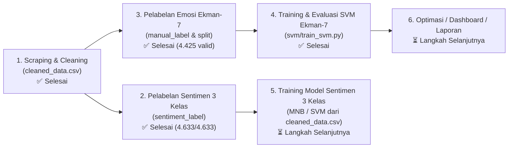

# Progress & Handoff Proyek Text Mining: Opini Publik Perpres No. 111 Tahun 2025

Dokumen ini merangkum progres pengerjaan dataset, pelabelan, pemodelan SVM yang sudah selesai, serta panduan langkah selanjutnya agar rekan tim dapat langsung melanjutkan pekerjaan tanpa mengulang dari awal.

---

## Ringkasan Status Saat Ini



Proyek ini memiliki **dua jalur (*track*) dataset berlabel** yang sama-sama sudah siap dipakai:
1. **Track A — Sentimen 3 Kelas (`positif`, `negatif`, `netral` + `noise`)** pada [cleaned_data.csv](file:///d:/TextMining_DataScrapper/cleaned_data.csv) (kolom `sentiment_label`) dengan konteks `root_tweet_text`.
2. **Track B — Klasifikasi Emosi 7 Kelas (Ekman-7)** pada [cleaned_data_auto_label_review.csv](file:///d:/TextMining_DataScrapper/output/cleaned_data_auto_label_review.csv) (kolom `manual_label`) beserta model SVM terlatih di [models/](file:///d:/TextMining_DataScrapper/models).

---

## 1. Track A: Dataset Utama Sentimen (`cleaned_data.csv`) — ✅ Selesai Dilabeli

Kolom `sentiment_label` di [cleaned_data.csv](file:///d:/TextMining_DataScrapper/cleaned_data.csv) telah terisi penuh (**4.633 / 4.633 baris**, **0 baris kosong**) menggunakan konteks `root_tweet_text` pada tiap *thread*.

### Metodologi & Revisi Pelabelan yang Sudah Dijalankan
1. **Pass 1 (Context-Aware Labeling):** Pelabelan awal memakai konteks `root_tweet_text` dan *pre-filter* 113 baris yang murni berisi `@mention` / URL saja sebagai `noise`.
2. **Pass 2 (Stance-Focused Revision):** Revisi menyeluruh pada 4.439 baris non-`noise` agar klasifikasi berfokus pada **sikap/pendapat substantif terhadap Perpres 111/2025** (bukan gaya bahasa/emosi teks), serta membedakan lanjutan utas penulis utama vs balasan warganet.
3. **Pass 3 (Tie-Breaker Adjudication):** Seluruh **319 baris** yang berbeda polaritas antara Pass 1 dan Pass 2 telah diajudikasi ulang hingga tuntas (`319 / 319` selesai) dan ditulis kembali ke [cleaned_data.csv](file:///d:/TextMining_DataScrapper/cleaned_data.csv).

### Distribusi Akhir `sentiment_label`

| Label | Jumlah | Proporsi | Definisi Operasional |
|---|---:|---:|---|
| `netral` | 2.282 | 49,26% | Berita administratif faktual tanpa keberpihakan, pertanyaan klarifikasi murni, atau obrolan di luar kebijakan Perpres |
| `negatif` | 1.533 | 33,09% | Kritik/penolakan terhadap Perpres 111/2025 (isu HAM, diskriminasi, persekusi, tuntutan cabut/revisi seperti KOMPAKS), tuduhan pengalihan isu, sindiran politik, atau kritik aturan lemah/omon-omon |
| `positif` | 553 | 11,94% | Dukungan, persetujuan, apresiasi, atau pembelaan terhadap Perpres 111/2025 & langkah pemerintah menindak penyebaran budaya LGBTQ+ |
| `noise` | 265 | 5,72% | Hanya mention/link saja, emoji/1 kata tanpa konteks sikap, promosi komersial, judol, pinjol, atau bot spam |
| **Total** | **4.633** | **100,00%** | **4.368 baris valid** (`sentiment_label != "noise"`) across **177 `conversation_id`** |

> [!CAUTION]
> **Jangan jalankan `python clean_data.py` sembarangan tanpa backup.** Skrip [clean_data.py](file:///d:/TextMining_DataScrapper/clean_data.py) membangun ulang [cleaned_data.csv](file:///d:/TextMining_DataScrapper/cleaned_data.csv) dari file `.txt` mentah dan mengisi `sentiment_label` dengan string kosong `""`, sehingga akan menimpa seluruh hasil pelabelan di atas.

---

## 2. Track B: Klasifikasi Emosi Ekman-7 & Model SVM — ✅ Selesai Dilatih

Pipeline emosi 7 kelas (`marah`, `netral`, `sedih`, `senang`, `terkejut`, `takut`, `jijik`) sudah lengkap dan dievaluasi pada data uji (*held-out test set*):

- **Validasi `manual_label`:** 4.425 baris opini valid di [cleaned_data_auto_label_review.csv](file:///d:/TextMining_DataScrapper/output/cleaned_data_auto_label_review.csv) sudah terisi (208 baris non-opini dikecualikan); 380 baris ditandai `ambigu` di `manual_notes`.
- **Group-Aware Split 50/20/30:** Tersimpan beku di [dataset_split.csv](file:///d:/TextMining_DataScrapper/output/dataset_split.csv) (**4.384** baris setelah hapus 3 baris kosong pasca-preprocessing & 38 duplikat teks; **178 grup**, **0 kebocoran grup** antar-split):
  - `train`: 2.192 baris (50,00%, 106 grup)
  - `val`: 878 baris (20,03%, 24 grup)
  - `test`: 1.314 baris (29,97%, 48 grup)
- **Model Terlatih Terbaik:** `LinearSVC_C0.3_cw-None_ng12` (`CalibratedClassifierCV` + `FeatureUnion` Word TF-IDF 1–2 gram & Char WB TF-IDF 3–5 gram).
- **Hasil Evaluasi Held-Out Test Set (1.314 baris):**
  - **Accuracy:** `0.5936` (59,36%)
  - **Macro-F1:** `0.3375`
  - **Weighted-F1:** `0.5261`
  - *Catatan:* Presisi kelas minoritas tinggi (`takut` 1,0000, `senang` 0,8333, `jijik` 0,8125), namun *recall* rendah karena dominasi kelas `marah` (~52,4%).

---

## 3. Daftar File Penting di Workspace

| File / Folder | Peran & Status |
|---|---|
| [cleaned_data.csv](file:///d:/TextMining_DataScrapper/cleaned_data.csv) | Dataset utama dengan `root_tweet_text` dan `sentiment_label` terisi lengkap (4.633 baris) |
| [README.md](file:///d:/TextMining_DataScrapper/README.md) | Dokumentasi skema kolom, scraper, dan catatan anotasi |
| [svm/train_svm.py](file:///d:/TextMining_DataScrapper/svm/train_svm.py) | Skrip training & evaluasi SVM (*group-aware split*, tuning validation Macro-F1, ekspor model & plot) |
| [svm/preprocessing.py](file:///d:/TextMining_DataScrapper/svm/preprocessing.py) | Normalisasi teks X Indonesia/Inggris, *negation joining*, stemming ringan, `TextCleanerTransformer` |
| [svm/predictor.py](file:///d:/TextMining_DataScrapper/svm/predictor.py) | API inferensi (`EmotionPredictor`, `predict_emotion`, `predict_batch`) siap integrasi dashboard |
| [svm/WORKFLOW.md](file:///d:/TextMining_DataScrapper/svm/WORKFLOW.md) | Log progres pipeline SVM Ekman-7 |
| [models/svm_ekman7_pipeline.joblib](file:///d:/TextMining_DataScrapper/models/svm_ekman7_pipeline.joblib) | Pipeline SVM Ekman-7 terlatih (juga disalin ke [best_svm_pipeline.joblib](file:///d:/TextMining_DataScrapper/models/best_svm_pipeline.joblib)) |
| [models/model_metadata.json](file:///d:/TextMining_DataScrapper/models/model_metadata.json) | Metadata konfigurasi terbaik dan metrik test set |
| [output/dataset_split.csv](file:///d:/TextMining_DataScrapper/output/dataset_split.csv) | Pembagian beku train/val/test berbasis `conversation_id` untuk Track B |
| [output/svm_ekman7_evaluation_report.json](file:///d:/TextMining_DataScrapper/output/svm_ekman7_evaluation_report.json) | Laporan metrik lengkap per kelas untuk SVM Ekman-7 |
| [output/svm_ekman7_tuning_results.csv](file:///d:/TextMining_DataScrapper/output/svm_ekman7_tuning_results.csv) | Hasil komparasi 12 kandidat hyperparameter pada validation set |
| [output/svm_ekman7_confusion_matrix.png](file:///d:/TextMining_DataScrapper/output/svm_ekman7_confusion_matrix.png) | Heatmap confusion matrix test set (CSV juga tersedia di [svm_ekman7_confusion_matrix.csv](file:///d:/TextMining_DataScrapper/output/svm_ekman7_confusion_matrix.csv)) |

---

## 4. Langkah Selanjutnya untuk Melanjutkan Pekerjaan

Pilih alur kerja di bawah ini sesuai target tugas akhir / riset yang sedang dikerjakan:

### Jalur 1 — Melatih Model Sentimen 3 Kelas dari `cleaned_data.csv` (Prioritas Utama jika targetnya `positif`/`negatif`/`netral`)
1. **Filter & Siapkan Data Latih:**
   - Baca [cleaned_data.csv](file:///d:/TextMining_DataScrapper/cleaned_data.csv) dan buang baris `sentiment_label == "noise"` sehingga tersisa **4.368 baris valid** (`netral`: 2.282, `negatif`: 1.533, `positif`: 553).
   - Opsional: lakukan *spot-check* manual pada sampel acak tiap kelas untuk verifikasi kualitas akhir.
2. **Preprocessing & Deduplikasi:**
   - Gunakan kembali fungsi `preprocess_text` / `TextCleanerTransformer` dari [preprocessing.py](file:///d:/TextMining_DataScrapper/svm/preprocessing.py), lalu buang teks duplikat setelah preprocessing sebelum melakukan split.
3. **Group-Aware Split:**
   - Gunakan `conversation_id` (atau `root_tweet_id`) sebagai grup saat melakukan split train/val/test (bisa mencontoh `create_group_stratified_split` di [train_svm.py](file:///d:/TextMining_DataScrapper/svm/train_svm.py)) agar balasan dalam satu *thread* tidak bocor antara train dan test.
4. **Training & Perbandingan Algoritma:**
   - Latih **Multinomial Naive Bayes** (sesuai topik di [README.md](file:///d:/TextMining_DataScrapper/README.md#L93) & [x_scraper.py](file:///d:/TextMining_DataScrapper/x_scraper.py#L7)) dan/atau **SVM 3 kelas** (`LinearSVC` / `SVC`).
   - Perhatikan ketidakseimbangan kelas (`positif` hanya ~12,7% dari data valid): evaluasi wajib melaporkan **Macro-F1**, **Weighted-F1**, **per-class Precision/Recall/F1**, dan **Confusion Matrix**, bukan sekadar Accuracy.

### Jalur 2 — Peningkatan Model Emosi SVM Ekman-7 (Jika melanjutkan Track B)
1. **Audit Baris Ambigu:** Tinjau 380 baris berlabel `manual_notes == "ambigu"` di [cleaned_data_auto_label_review.csv](file:///d:/TextMining_DataScrapper/output/cleaned_data_auto_label_review.csv).
2. **Atasi Recall Kelas Minoritas:**
   - Uji coba skema 5 kelas (`python -m svm.train_svm --scheme main5 --reuse-split`) untuk membandingkan kestabilan Macro-F1.
   - Atau lakukan eksperimen `class_weight="balanced"` tanpa kalibrasi sigmoid / *threshold tuning* pada validation set agar kelas minoritas (`takut`, `terkejut`, `sedih`, `senang`, `jijik`) tidak tertelan kelas `marah`.
3. **Uji Inferensi Cepat:**
   ```bash
   python -m svm.predictor "Ini pengalihan isu doang atau gimana?"
   ```
